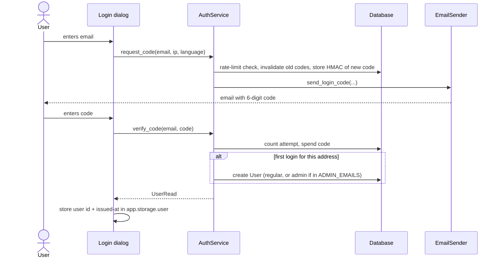

# New user workflow (sign-up = first login)

DriveWise has **no separate sign-up**. Login is passwordless (a 6-digit one-time code sent by
email), and an account is created automatically the first time an address logs in successfully.

Code: [`backend/app/services/auth.py`](../../backend/app/services/auth.py) (`AuthService`),
[`backend/app/ui/auth.py`](../../backend/app/ui/auth.py) (`AuthState`, session),
[`backend/app/ui/components/login_dialog.py`](../../backend/app/ui/components/login_dialog.py),
[`backend/app/services/mailer.py`](../../backend/app/services/mailer.py) (email delivery).

## 1. Request a code — `AuthService.request_code`

Triggered when the user submits an email in the login dialog (`AuthState.request_code`, run via
`run.io_bound`).

1. **Normalize the email** – stripped, lowercased, loosely validated (one `@`, a dot in the
   domain, max 320 chars). Otherwise `invalid_email`.
2. **Purge** codes that expired more than a day ago.
3. **Rate limit** – at most `LOGIN_CODE_MAX_REQUESTS_PER_EMAIL_HOUR` requests per address and
   `LOGIN_CODE_MAX_REQUESTS_PER_IP_HOUR` per IP in the last hour. Otherwise `rate_limited`.
4. **Invalidate** every still-outstanding code for the address.
5. **Generate** a random 6-digit code and store only its HMAC-SHA256 (key `AUTH_SECRET`, bound to
   the address) with an expiry of `LOGIN_CODE_TTL_MINUTES`. The row is committed *before* sending,
   so no DB transaction is held open across the SMTP call.
6. **Send** the code in the UI language (`cs`/`en`) through `EMAIL_BACKEND`:
   - `console` – printed to the server log (development only),
   - `smtp` – real email via `SMTP_*` settings.

   If delivery fails, the code is burned and the user gets `email_delivery_failed`.

## 2. Verify the code — `AuthService.verify_code`

1. Normalize the email again; take the **newest** unused, unexpired code for it. None →
   `invalid_code`.
2. **Count the attempt atomically in SQL** (`attempts + 1`, guarded by
   `LOGIN_CODE_MAX_ATTEMPTS`) so parallel guesses can't exceed the cap.
3. Compare in constant time (`hmac.compare_digest`).
   - Wrong code → `invalid_code`; on the last allowed attempt the code is burned →
     `too_many_attempts` (a new code must be requested).
   - Wrong, expired, used and missing codes all report `invalid_code` on purpose.
4. Correct code → **spend it** (single use, conditional update so it is spent exactly once).

## 3. Create the account (first successful login only)

Still inside `verify_code`:

| Situation | Result |
|---|---|
| No `User` with this email | New `User(email, is_active=True, created_at=now, is_admin = email in ADMIN_EMAILS)` |
| Existing user, now listed in `ADMIN_EMAILS` | Promoted to admin |
| Existing user with `is_active=False` | Refused with `account_disabled` |

Then `last_login_at` is set and the transaction committed.

## 4. Start the session — `AuthState.verify_code`

- Two keys go into NiceGUI's `app.storage.user` (server-side store behind the signed session
  cookie, `NICEGUI_STORAGE_SECRET`): `auth_user_id` and `auth_issued_at`. Nothing else about the
  user is cached.
- On every page load `AuthState.refresh()` re-reads the user from the DB, so deactivation or
  demotion takes effect on the next load.
- Sessions older than `AUTH_SESSION_DAYS` are dropped server-side regardless of the cookie.
- Logout removes just those two keys.

## Roles after sign-up

| Role | How it is obtained |
|---|---|
| Regular user | Automatically, on first login (chat, feedback, author request) |
| Author | User requests it, an admin approves it in the authors admin panel (`app/services/authors.py`) |
| Admin | Only via `ADMIN_EMAILS` or granted by another admin |

## Error codes shown to the user

`invalid_email`, `rate_limited`, `email_delivery_failed`, `invalid_code`, `too_many_attempts`,
`account_disabled` – the UI maps each to localized text.

## Configuration

All in [`backend/app/core/config.py`](../../backend/app/core/config.py), set via environment:

| Variable | Default | Meaning |
|---|---|---|
| `EMAIL_BACKEND` | `console` | `console` (log only) or `smtp` |
| `SMTP_HOST`, `SMTP_PORT`, `SMTP_USER`, `SMTP_PASSWORD`, `SMTP_FROM`, `SMTP_FROM_NAME`, `SMTP_SECURITY` | – | SMTP delivery (see `backend/README.md`, Login section) |
| `LOGIN_CODE_TTL_MINUTES` | 10 | Code validity |
| `LOGIN_CODE_MAX_ATTEMPTS` | 5 | Wrong guesses before the code is burned |
| `LOGIN_CODE_MAX_REQUESTS_PER_EMAIL_HOUR` | 5 | Code requests per address per hour |
| `LOGIN_CODE_MAX_REQUESTS_PER_IP_HOUR` | 20 | Code requests per IP per hour |
| `ADMIN_EMAILS` | empty | Comma-separated addresses that become admins |
| `AUTH_SECRET` | `NICEGUI_STORAGE_SECRET` | HMAC key for stored codes |
| `AUTH_SESSION_DAYS` | 30 | Maximum session age |

## Notes

- **Open registration:** anyone who can receive mail at an address can create a regular account.
  There is no allowlist, CAPTCHA or admin approval; only the rate limits above apply.
- The plaintext code exists only in the email (and, with `EMAIL_BACKEND=console`, in the server
  log – never use `console` in production).
